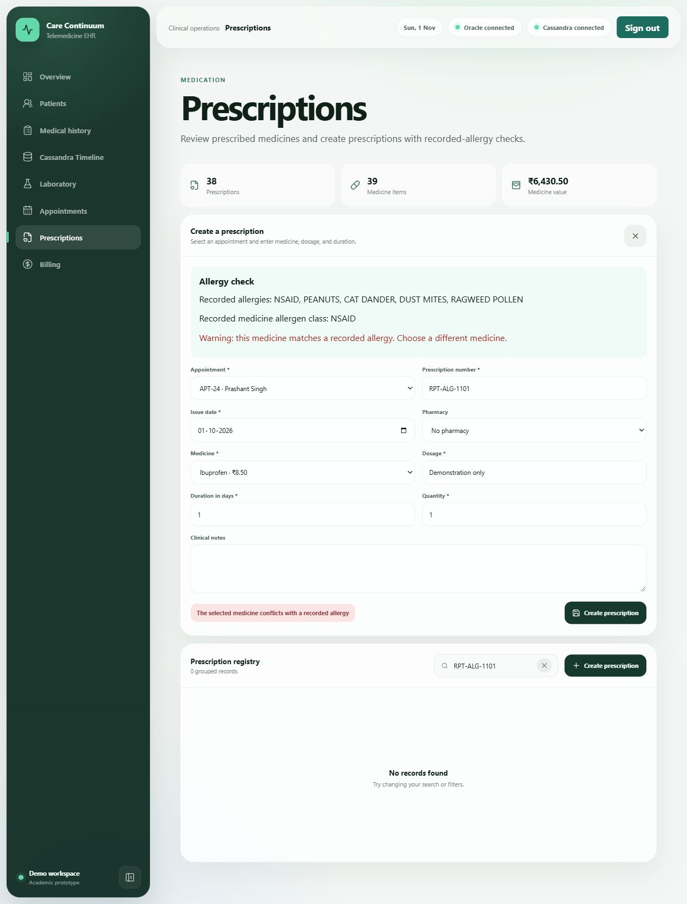

# Care Continuum: Telemedicine Consultation and Electronic Health Records

[Live application](https://telemedicine-consultation-ehr-syste.vercel.app/) · [Screenshots](screenshots/README.md) · [Tests and results](tests/README.md) · [Database design](docs/README.md)

**Course:** BACSE202 - Database Management Systems · **Semester:** Fall 2026–2027

**Faculty:** Dr. S. Geetha · **Slot:** D1 + TD1

| Team member | Register number |
| --- | --- |
| Pratyush Deo Singh | 25BCE5101 |
| Dhuna Vijay Chavda | 25BCE1072 |
| Sarbajeet Pattadar | 25BCE1920 |

**YouTube demonstration:** _To be published — link will be added here._

## Problem statement

Patient registration, consultation records, prescriptions, laboratory results and invoices are often maintained separately. Staff need a connected workflow that preserves patient identity, prevents inconsistent records and provides access to clinical history. This project supports clinical administration through an Oracle-backed application, with a Cassandra extension for chronological patient/month reads.

## Abstract

Care Continuum is a database-backed telemedicine and electronic health record application. It connects patient registration, medical history, appointments, prescriptions, laboratory orders, results and billing through 18 Oracle tables. Keys, constraints, PL/SQL procedures, a calculation function and triggers enforce relational and transactional rules, including rejection of medicines matching recorded allergy classes and automatic creation of virtual-session metadata. A React interface accesses the database through an Express API. A Cassandra extension stores imported clinical events by patient and month for timeline queries. The project includes reproducible SQL/CQL scripts, synthetic sample data, automated tests, integration checks and screenshots documenting implemented behavior.

## Functional features

| Module | Implemented behavior |
| --- | --- |
| Patients | Registration, search, phone records and insurance details. |
| Medical history | Dated diagnoses, medicine-class allergies and other recorded allergies. |
| Appointments | Virtual/in-person booking, status updates and automatic virtual-session metadata. |
| Prescriptions | Medicine items, quantities and dosage saved transactionally; allergy conflicts rejected. |
| Laboratory | Catalog-based orders, test results, remarks and document references. |
| Billing | Calculated invoices, charge breakdowns, reconciliation and payment/refund status. |
| Cassandra timeline | Patient/month partition reads, paging and explicit refresh from Oracle. |
| Hosted access | Shared demonstration login and separate database availability indicators. |

## Technology and requirements

| Component | Software/version |
| --- | --- |
| Operational database | Oracle Autonomous Database: **Oracle AI Database 26ai Enterprise Edition, 23.26.4.1.0**, recorded in [database evidence](tests/results/2026-11-01/database-evidence.json) |
| Timeline database | Apache Cassandra **5.0.9** locally; Astra DB for hosted access |
| Backend | Node.js **24.x**, Express **5**, node-oracledb **7**, cassandra-driver **4.10** |
| Frontend | React **19**, Vite **8**, React Router **7**, CSS |
| Package management | npm for backend/root; pnpm **11.22.0** through Corepack for frontend |
| Deployment | Vercel static frontend and Express API function |

An Oracle project schema must permit creation of tables, indexes, sequences, procedures, functions and triggers. Docker Desktop with Linux containers is needed for local Cassandra; Astra is an alternative. Default ports are **3000** (API), **5173** (frontend) and **9042** (local Cassandra). Only synthetic demonstration data is used. The hosted demonstration password is supplied separately.

## Repository structure

```text
README.md
backend/                  Express source, database adapters and verification scripts
  tests/                  Automated backend test source
frontend/                 React source and Vite configuration
api/                      Vercel API entry point
database/                 Oracle schema, sample data, SQL/PLSQL and upgrades
cassandra/                Cassandra schema, seeds, CQL and Docker setup
screenshots/              Numbered application and database evidence
tests/                    Test instructions, expected/actual results and output
  evidence/               Read-only evidence collector
  results/2026-11-01/      Dated verification records
docs/                     Architecture, ER diagram, relational schema, normalization
report/                   Final technical report PDF location
presentation/             Final presentation slide deck location
deploy/                   Environment and deployment instructions
package.json              Hosted API dependencies and Node version
vercel.json               Production build and routing configuration
```

Application source is separated into `backend/`, `frontend/` and `api/` rather than one `src/` directory. Automated test source remains in `backend/tests/`; submission test results are under `tests/`.

## Database design and sample data

| Domain | Oracle tables |
| --- | --- |
| Patient and coverage | PATIENT, PATIENT_PHONE, INSURANCE_PROVIDER |
| Clinical staff | DOCTOR, DOCTOR_QUALIFICATION, DEPARTMENT |
| Clinical history | MEDICAL_LOG, LOG_ALLERGIES |
| Consultations | APPOINTMENT, TELEMEDICINE_SESSION |
| Medicines | MEDICINE, PHARMACY, PRESCRIPTION, PRESCRIPTION_ITEM |
| Laboratory | LAB_TEST_CATALOG, LAB_ORDER, TEST_RESULT |
| Billing | BILLING_INVOICE |

Patients and doctors are linked through appointments. Appointments link to prescriptions, laboratory orders, invoices and sessions. Composite keys identify repeated child records; foreign keys maintain relationships and checks restrict status values. See the [relational schema](docs/relational-schema.md), [ER diagram](docs/README.md#er-diagram) and [normalization](docs/normalization.md).

Fresh Oracle setup supplies at least **25 synthetic rows per table**, including linked consultations, prescriptions, tests and invoices. Reserved `-S01` to `-S17` IDs identify extended sample records; existing databases can contain additional records. Sample dates, document references and meeting links do not imply hosted files or real consultations.

Cassandra uses `clinical_events_by_patient_month`, keyed by `((patient_id, event_month), event_time, event_id)`, with `event_time DESC, event_id ASC`. Copied summaries support partition reads; Oracle remains authoritative for operational transactions. See [architecture](docs/architecture.md).

## Run locally

### 1. Backend configuration

From the repository root, in a new checkout:

```powershell
cd backend
npm ci
Copy-Item .env.example .env
```

Edit `backend/.env` with your Oracle settings:

```dotenv
ORACLE_USER=your_schema_user
ORACLE_PASSWORD=your_schema_password
ORACLE_CONNECT_STRING=localhost:1521/your_service
PORT=3000
HOST=127.0.0.1
CORS_ORIGIN=http://localhost:5173
```

Autonomous Database wallet settings are described in [backend/.env.example](backend/.env.example) and [deploy/VERCEL.md](deploy/VERCEL.md). Edit existing `.env` files instead of overwriting them. Credentials, wallets and connection bundles must remain outside Git.

### 2. Oracle schema and sample data

**Use a new/disposable schema: `db:setup` drops existing project tables.** From `backend/`:

```powershell
npm run db:setup
npm start
```

Setup executes [database/telemedicine_ehr.sql](database/telemedicine_ehr.sql): schema and indexes, synthetic sample data, sequences, routines/triggers, then verification queries. The assignment's example `schema.sql` and `sample_data.sql` roles are combined in this executable file to preserve the tested seed/trigger creation order. [academic_seed.sql](database/academic_seed.sql) separately extends existing schemas. Follow [database/README.md](database/README.md) for upgrades and SQL execution.

### 3. Frontend

In a second terminal, from the repository root:

```powershell
cd frontend
corepack pnpm install --frozen-lockfile
Copy-Item .env.example .env.local
corepack pnpm dev
```

Use `VITE_API_URL=/api` and `VITE_USE_DEMO_DATA=false`. Open [http://localhost:5173](http://localhost:5173); Vite proxies requests to port 3000. Local development does not require the production login. Optional `VITE_USE_DEMO_DATA=true` enables a read-only preview without database connectivity.

### 4. Cassandra

For local Docker setup, run from the repository root:

```powershell
./cassandra/setup.ps1
```

Follow [cassandra/README.md](cassandra/README.md), enable Cassandra in `backend/.env`, then restart the API. For Astra use [deploy/CASSANDRA.md](deploy/CASSANDRA.md). Local `DEMO-*` CQL seeds are separate from imported Oracle patients. With a configured connection and existing keyspace, run from `backend/`:

```powershell
npm run timeline:setup
npm run timeline:import
```

The first command creates the timeline table; the second reads Oracle and upserts Cassandra events. **Cassandra Timeline → Refresh from Oracle** performs the import from the application.

### SQL and API reference

- [database/queries.sql](database/queries.sql): 14 labelled examples covering joins, aggregates, subqueries, set operations and PL/SQL calculations.
- [database/trigger_demo.sql](database/trigger_demo.sql): allergy-trigger rejection example.
- [cassandra/queries.cql](cassandra/queries.cql): partition/date reads, ordering, limits and isolated CRUD examples.
- [backend/README.md](backend/README.md): API endpoints and response codes.
- [deploy/VERCEL.md](deploy/VERCEL.md): hosted environment and deployment.

## Screenshots and testing

[screenshots/README.md](screenshots/README.md) indexes application screens, allergy rejection/rollback, automatic sessions and Cassandra results. Figures 15–18 capture labelled transcripts of **actual verification results**, rather than a SQL terminal. The historical refresh screenshot is dated separately.



From `backend/`, run `npm test` and `npm run db:verify-workflows`. From `frontend/`, run `corepack pnpm lint` and `corepack pnpm build`. The recorded backend suite has **13 passing tests**. The Oracle verifier checks allergy rejection/rollback, automatic sessions, input validation, laboratory workflows and billing transitions, then rolls back its test writes. Read-only Cassandra checks verified five events over three pages, invalid-month rejection and empty-partition handling.

[tests/README.md](tests/README.md) provides commands, data effects, expected/actual results and dated output. The captured application had 38 patients and 38 prescriptions; these are snapshot counts, not fixed seed requirements.

## Known limitations

- Allergy matching compares recorded medicine classes; ingredient inference and cross-reactivity are not implemented.
- Virtual consultations store metadata, without video calls. Attachment fields store references, without file uploads.
- Payment/refund statuses do not transfer money. Billing uses current catalog prices; historical pricing and insurance claims are not implemented.
- Production uses one shared demonstration login, without individual user roles.
- Cassandra refresh is an explicit import, with no cross-database transaction. Source deletions/date changes can leave older rows; the timeline is not an immutable audit log.
- Local Cassandra has one node and replication factor one; multi-node failover/scaling is not demonstrated. Website refresh is limited to 2,000 events and uses an instance-local overlap guard.
- Cleanup verification does not include a destructive fresh-schema rebuild of the configured databases.

## Submission artifacts

The final report belongs at `report/DBMS_Project_Report.pdf`; the final slides belong at `presentation/DBMS_Project_Presentation.pptx`. These exports have not yet been supplied. The YouTube link will be added above after publication. The course submission Word document is separate and must contain the course/team details and working repository/video links.

## Principal technical references

1. Oracle, [SQL Language Reference](https://docs.oracle.com/en/database/oracle/oracle-database/23/sqlrf/).
2. Oracle, [PL/SQL Language Reference](https://docs.oracle.com/en/database/oracle/oracle-database/23/lnpls/).
3. Oracle, [node-oracledb documentation](https://node-oracledb.readthedocs.io/en/latest/).
4. Apache Software Foundation, [Cassandra documentation](https://cassandra.apache.org/doc/latest/).
5. DataStax, [Node.js driver documentation](https://docs.datastax.com/en/developer/nodejs-driver/4.8/).
6. [React](https://react.dev/), [Express](https://expressjs.com/) and [Vite](https://vite.dev/) documentation.

Dependency versions and lockfiles accompany the source. No base research paper is claimed; these are the principal technical references.
