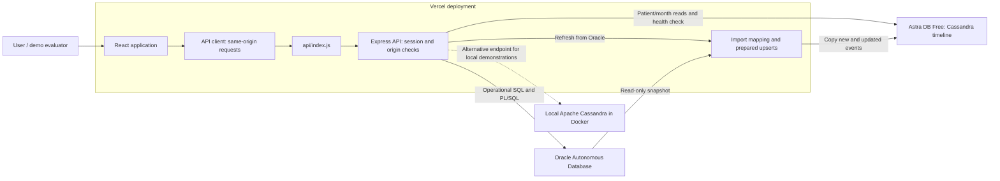
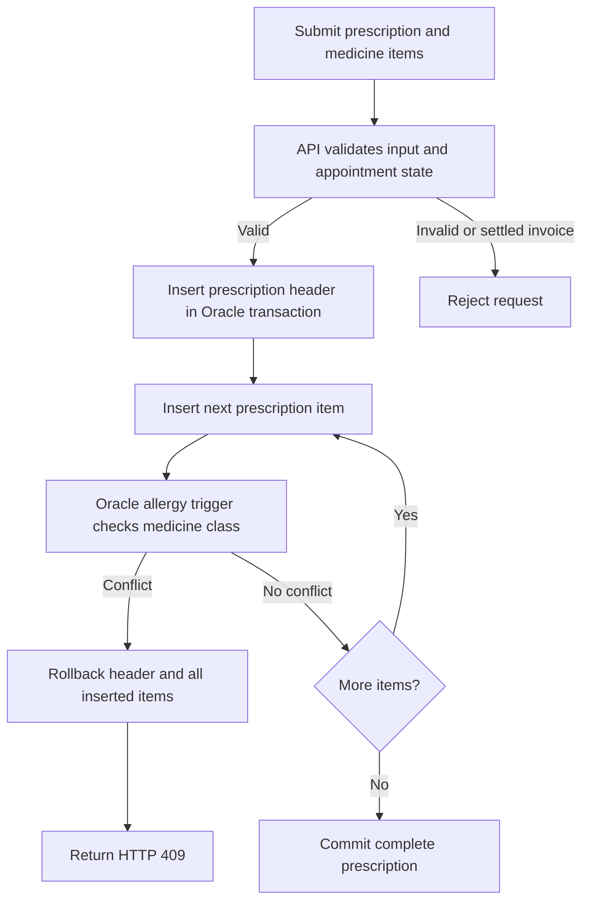
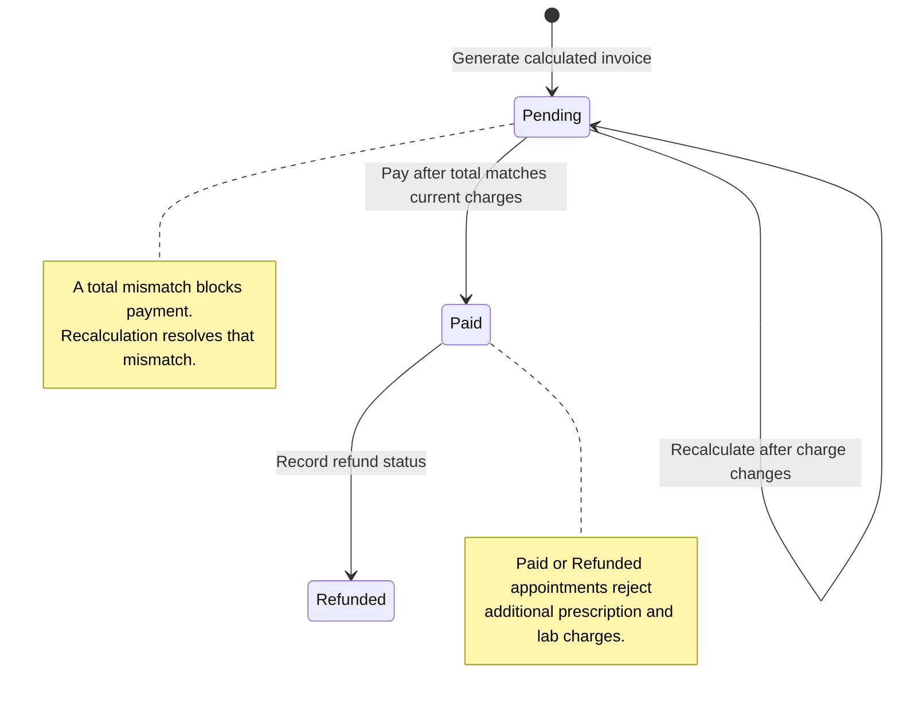
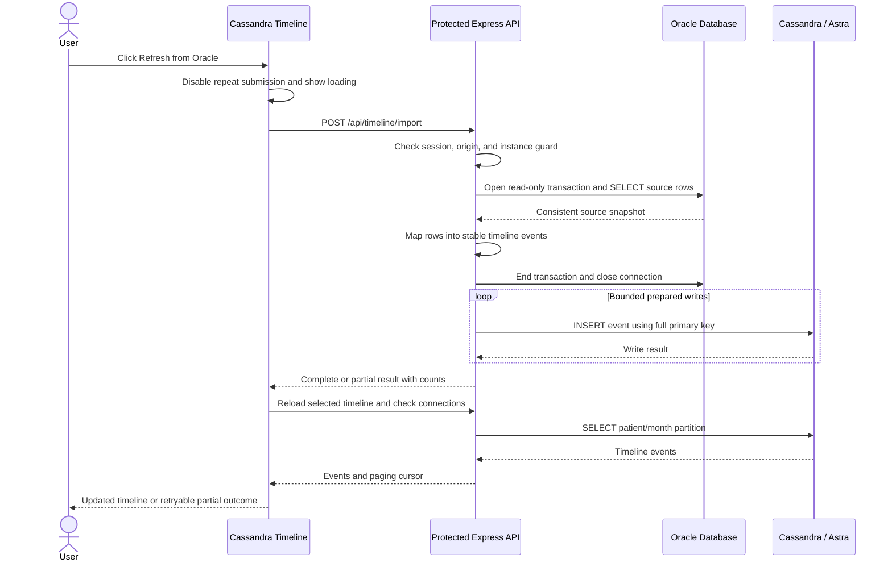
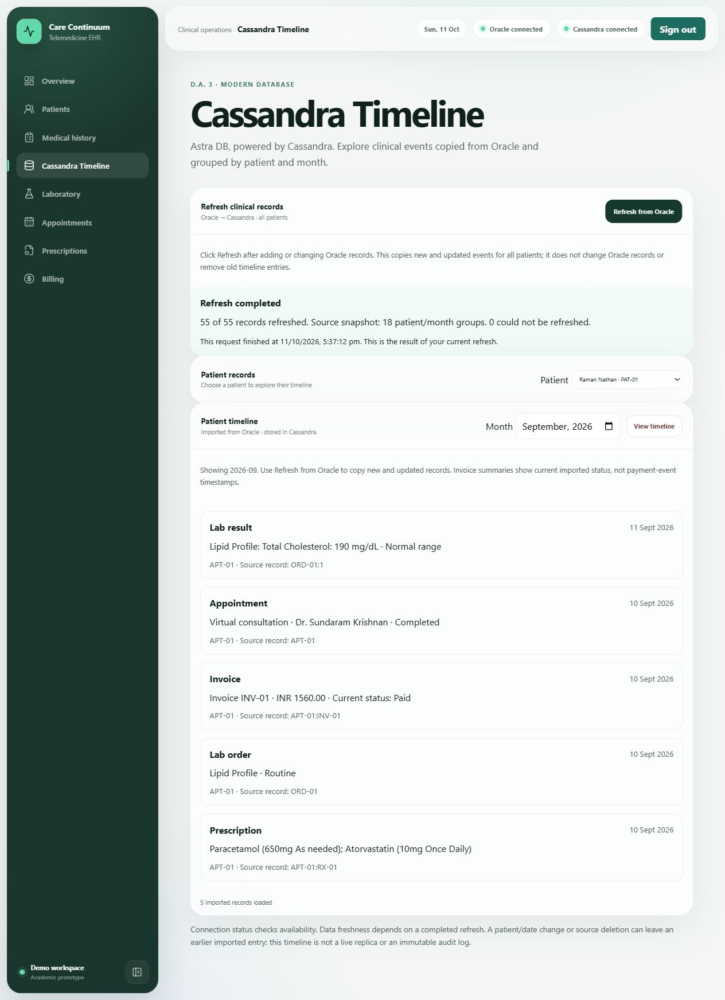

# Care Continuum

**A telemedicine and electronic health record project combining Oracle business workflows with a Cassandra patient timeline.**

[Live application](https://telemedicine-consultation-ehr-syste.vercel.app/) · [Cassandra Timeline](https://telemedicine-consultation-ehr-syste.vercel.app/cassandra-timeline) · [API reference](backend/README.md) · [Study guide](docs/DA3_STUDY_GUIDE.md)

Care Continuum follows a patient's journey through registration, medical history, consultation, prescription, laboratory testing, and billing. Oracle stores the operational records and enforces relational and transactional rules. The Cassandra extension groups imported clinical events by patient and month for a chronological view.

The application is implemented and deployed on Vercel. The hosted databases are Oracle Autonomous Database and Astra DB Free; local Cassandra demonstrations use Apache Cassandra 5.0.9 in Docker. Production requires a shared demo password. All records are synthetic academic demonstration data.

## Contents

- [Project scope](#project-scope)
- [System architecture](#system-architecture)
- [Application modules](#application-modules)
- [Oracle database design](#oracle-database-design)
- [Cassandra model and refresh](#cassandra-model-and-refresh)
- [Component responsibilities](#component-responsibilities)
- [Technology stack](#technology-stack)
- [Repository structure](#repository-structure)
- [Run locally](#run-locally)
- [Verification](#verification)
- [Deployment and configuration](#deployment-and-configuration)
- [Implemented boundaries](#implemented-boundaries)
- [Documentation and presentation](#documentation-and-presentation)

## Project scope

| Assignment | Contribution | Significance |
| --- | --- | --- |
| D.A. 1 | ER/EER modeling, relational mapping, and normalization work | Establishes entities, relationships, keys, and the relational design. |
| D.A. 2 | Oracle schema, sample data, SQL demonstrations, PL/SQL routines, triggers, and application workflows | Demonstrates relational integrity, query operations, and transactions in a working interface. |
| D.A. 3 | Cassandra schema, CQL examples, persistent local service, Oracle import, and a dedicated cloud-connected timeline | Demonstrates a wide-column model, query-oriented denormalization, partitions, and integration with the same project. |

The implementation supports the assignment's database demonstrations. The handwritten reports and individual/team explanations remain academic deliverables; the [study guide](docs/DA3_STUDY_GUIDE.md) provides preparation material.

## System architecture



The React application calls one API rather than accessing either database directly. Oracle remains the source for operational decisions such as allergy rejection and invoice calculations. Cassandra serves the additional patient/month timeline. Refresh copies information between the databases; it is an application import, not database replication or a shared distributed transaction.

During local development, Vite proxies `/api` to Express on port 3000. On Vercel, static frontend files and the API function share the application origin. The API connects to Oracle using wallet-based mutual TLS and to Astra using a Secure Connect Bundle and scoped token. Credentials remain on the server.

## Application modules

| Module | Implemented capabilities | Role in the project |
| --- | --- | --- |
| Overview | Patient/prescription counts, scheduled consultations, and outstanding invoices | Summarizes operational records for quick navigation. |
| Patients | Search, registration, and links to patient history | Provides the patient identity referenced throughout the schema. |
| Medical history | Dated diagnoses, medicine-class allergies, other recorded allergies, and attachment references | Retains clinical background and supplies the recorded allergy information used by the prescription rule. |
| Appointments | Virtual/in-person booking and status updates | Connects patients and doctors and anchors prescriptions, lab orders, and invoices. |
| Prescriptions | Medicine items, dosage, duration, quantity, price information, and creation | Demonstrates parent/child records and transactional allergy validation. |
| Laboratory | Catalog-based test orders, priorities, result values, remarks, and report references | Models test selection and separately recorded results; ordered tests contribute to invoice calculations. |
| Billing | Calculated invoices, charge breakdowns, pending-total recalculation, Paid/Refunded status | Connects consultation-related medicine and laboratory charges with controlled status transitions. |
| Cassandra Timeline | Patient/month selection, chronological events, paging, and Refresh from Oracle | Presents the D.A. 3 extension through actual Cassandra reads and prepared writes. |
| Connection indicators | Separate Oracle and Cassandra health checks with click-to-retry | Distinguishes database availability from the age of imported data. |
| Demo login | Shared-password sign-in and signed session cookie in production | Restricts access to the hosted demonstration's data routes. |

### Prescription validation and rollback

Known medicine allergy classes are selected from the medicine catalog. Other allergies are stored for review. Oracle's `PREVENT_ALLERGIC_PRESCRIPTION` trigger rejects a prescription item when the medicine's class matches a recorded patient allergy.



This rule runs in the database, so a failed item cannot leave a partially saved prescription. Class matching ignores case and surrounding whitespace. It does not infer ingredients, synonyms, or cross-reactivity; missing allergy information is not proof of medicine safety.

### Billing lifecycle

The API calculates invoice totals from medicine quantities multiplied by current catalog prices, plus ordered laboratory test costs. It supports one API-generated invoice per appointment.



Payment and refund actions record invoice status; they do not transfer money. Recalculation updates a pending invoice to the current calculated total. Existing lab orders can still receive results after an invoice is settled.

## Oracle database design

The schema contains **18 related tables**, supported by primary/foreign keys, check constraints, sequences, and indexes. The complete definitions and sample data are in [database/telemedicine_ehr.sql](database/telemedicine_ehr.sql).

| Domain | Tables | Significance |
| --- | --- | --- |
| Patient identity | `PATIENT`, `PATIENT_PHONE`, `INSURANCE_PROVIDER` | Separates patient details, repeatable phone records, and insurance-provider references. |
| Clinical staff | `DOCTOR`, `DOCTOR_QUALIFICATION`, `DEPARTMENT` | Associates doctors with departments and repeatable qualifications. |
| History and allergies | `MEDICAL_LOG`, `LOG_ALLERGIES` | Stores dated history entries and their associated allergy records. |
| Consultations | `APPOINTMENT`, `TELEMEDICINE_SESSION` | Connects patients/doctors and stores metadata for virtual consultations. |
| Medicines and prescriptions | `MEDICINE`, `PHARMACY`, `PRESCRIPTION`, `PRESCRIPTION_ITEM` | Separates medicine/catalog information from prescription headers and individual items. |
| Laboratory | `LAB_TEST_CATALOG`, `LAB_ORDER`, `TEST_RESULT` | Separates available tests, requested tests, and reported results. |
| Invoicing | `BILLING_INVOICE` | Stores appointment-linked totals and invoice status. |

### Website coverage of all 18 Oracle tables

All 18 tables participate in website features. Usage does not mean that every table has a separate page or supports every CRUD operation; reference data is read where it helps a workflow.

| Table | Website feature and use |
| --- | --- |
| `PATIENT` | Patient directory and registration; patient selection throughout care workflows. |
| `PATIENT_PHONE` | Patient directory displays each patient's phone numbers, including multiple numbers. |
| `INSURANCE_PROVIDER` | Registration selects a stored policy; patient records show provider and coverage limit through a `LEFT JOIN`. Coverage is informational, not an insurance claim calculation. |
| `DOCTOR` | Appointment booking selects a doctor and shows their specialization. |
| `DOCTOR_QUALIFICATION` | Selecting a doctor during booking displays all recorded qualifications. |
| `DEPARTMENT` | Doctor and appointment queries display the doctor's department. |
| `MEDICAL_LOG` | Medical history displays and creates dated clinical entries. |
| `LOG_ALLERGIES` | History records allergies; prescription safety checks use them. |
| `APPOINTMENT` | Consultation booking, listing and status updates link patients to doctors. |
| `TELEMEDICINE_SESSION` | Virtual appointment cards expand to show session times, network notes and transcript references. The booking trigger creates a placeholder session. |
| `PHARMACY` | Prescription creation selects an optional dispensing pharmacy. |
| `MEDICINE` | Prescription item selection, medicine prices and known allergen classes. |
| `PRESCRIPTION` | Prescription headers displayed and created for appointments. |
| `PRESCRIPTION_ITEM` | Individual medicines, dosage, duration and quantity; used by the allergy trigger and invoice calculation. |
| `LAB_TEST_CATALOG` | Lab ordering selects tests and displays their standard charges. |
| `LAB_ORDER` | Lab requests displayed and created for appointments. |
| `TEST_RESULT` | Lab results displayed and recorded against orders. |
| `BILLING_INVOICE` | Invoice generation, reconciliation, recalculation and payment/refund status. |

Phone numbers and qualifications are read as simple child-table queries and grouped in JavaScript, preserving patients/doctors with no child records. These reference records remain maintained through Oracle SQL; there are no website editors for phone numbers, qualifications or insurance-provider catalogs. Transcript paths are stored references, not downloadable files hosted by this application. The separate Cassandra timeline uses one additional table, `clinical_events_by_patient_month`.

For a professor's demonstration, open **Patients** to show phones and insurance, open **Register patient** to show policy selection, select a doctor in **Book appointment** to show qualifications, and expand a virtual appointment's **Telemedicine session records**. The remaining table usage is visible in Medical history, Prescriptions, Lab tests and Billing.

### PL/SQL objects

| Object | Type | Responsibility |
| --- | --- | --- |
| `REGISTER_NEW_PATIENT` | Procedure | Registers a patient using a generated identifier. |
| `UPDATE_APPOINTMENT_STATUS` | Procedure | Changes status and rejects unknown appointments. |
| `CALCULATE_INVOICE_TOTAL` | Function | Calculates medicine and laboratory charges. |
| `PREVENT_ALLERGIC_PRESCRIPTION` | Trigger | Rejects matching medicine-class allergy conflicts. |
| `TRG_CREATE_TELEMEDICINE_SESSION` | Trigger | Creates placeholder session metadata for a new virtual appointment. |

Oracle sequences generate patient and appointment identifiers. The API generates new lab-order/invoice identifiers and allocates child history/result numbers under a parent-row lock. Related write statements commit together or roll back on failure. Virtual-session metadata does not provide a video-calling service.

[database/queries.sql](database/queries.sql) contains 14 labeled SQL/PLSQL demonstrations. The [database guide](database/README.md) explains schema initialization and upgrades.

## Cassandra model and refresh

### Query-oriented timeline model

The `care_continuum` keyspace contains the `clinical_events_by_patient_month` table. Its primary key is:

```cql
PRIMARY KEY ((patient_id, event_month), event_time, event_id)
```

| Column group | Purpose |
| --- | --- |
| `patient_id`, `event_month` | Composite partition key grouping one patient's events for one calendar month. |
| `event_time`, `event_id` | Clustering columns ordering events and distinguishing records with the same timestamp. |
| `event_type`, `summary` | Prepared display information for the timeline. |
| `patient_name`, `appointment_id`, `source_record_id` | Context and references back to the source records. |

Clustering order is `event_time DESC, event_id ASC`. The application queries the complete partition key and returns signed paging cursors. Medical history, appointments, prescriptions, lab orders, lab results, and invoices map to six event types. Oracle calendar dates are mapped to UTC midnight to retain their source date and month.

```cql
SELECT event_time, event_type, summary
FROM care_continuum.clinical_events_by_patient_month
WHERE patient_id = 'PAT-01'
  AND event_month = '2026-09'
LIMIT 5;
```

The model deliberately stores prepared summaries instead of reproducing Oracle's normalized tables. It supports the chosen patient/month read pattern; it is not intended for arbitrary SQL-style joins and filters. See the [CQL query guide](docs/DA3_QUERY_GUIDE.md) and [Oracle/Cassandra comparison](docs/DA3_COMPARISON.md).

### Refresh from Oracle

Users refresh through the website; the terminal importer remains a maintenance option.



Refresh copies **all patients'** source events, not only the selected month. It does not change Oracle records or create database tables. Repeated inserts with the same full primary key update existing rows rather than creating duplicates.

If some Cassandra writes fail, successful writes remain. The page displays a partial result and offers retry. Oracle and Cassandra do not participate in one atomic transaction. Source deletions or date changes can leave old timeline rows; automatic removal/reconciliation is not implemented.

Website refresh has a 2,000-row limit per Oracle source query and a 2,000-event limit after mapping. A 120-second budget stops dispatching new writes, and in-flight queries are awaited. Up to four prepared writes run concurrently; the Vercel function limit is 180 seconds. Overlap protection applies within one backend instance, not across separate Vercel instances.

Connection badges report availability, not synchronization. The displayed completion time belongs to the current page's refresh request and is not a persistent global last-import timestamp.

## Component responsibilities

### Frontend

| Component/file | Responsibility | Significance |
| --- | --- | --- |
| `main.jsx` | Mounts React and routing providers | Application bootstrap. |
| `App.jsx` | Session checks, login gating, and page routes | Defines which screens the user can reach. |
| `AppShell.jsx` | Desktop/mobile navigation, header, status indicators, and sign-out | Shared layout across all modules. |
| `LoginScreen.jsx` | Demo-password entry and login feedback | Production access entry point. |
| `pages/` | Overview, patients, history, appointments, prescriptions, laboratory, billing, and Cassandra screens | Organizes the interface around the project's workflows. |
| `CassandraTimelinePage.jsx` | Patient selection, refresh request, result/error states, and URL parameters | Coordinates the dedicated D.A. 3 experience. |
| `PatientTimeline.jsx` | Month selection, event rendering, paging, cancellation, and retry | Reads Cassandra without issuing an Oracle import when merely viewing records. |
| `ConnectionStatus.jsx` | Independent checks for each database and rechecks after refresh | Prevents one database's availability from being confused with the other's. |
| `EntryForm.jsx`, `ActionFeedback.jsx` | Reusable entry fields, submission state, and feedback | Provides consistent data-entry behavior. |
| `DataState.jsx`, `useApiResource.js` | Loading, empty/error views, retry, and resource lifecycle | Makes asynchronous API behavior visible to the user. |
| `PageHeader.jsx`, `Surface.jsx` | Page headings and content containers | Maintains consistent screen structure. |
| `SearchField.jsx`, `StatusBadge.jsx` | Search input and status presentation | Supports filtering and readable record states. |
| `api/client.js` | Requests, session actions, database checks, and write methods | Keeps API details out of individual page components. |
| `api/demoData.js` | Synthetic read-only preview records | Allows interface preview without database connections. |
| `utils/formatters.js` | Shared dates, currency, and display formatting | Keeps presentation consistent. |
| `index.css` | Responsive layout, component styles, and interaction states | Supports desktop/mobile use and readable workflows. |

Frontend source is under [frontend/src](frontend/src). React and CSS support the interface; SQL, PL/SQL, and CQL provide the database functionality.

### Backend and deployment

| Component/file | Responsibility | Significance |
| --- | --- | --- |
| `backend/server.js` | Express setup, production security/session checks, core Oracle routes, and route registration | Central API entry point for local and hosted use. |
| `backend/clinicalRoutes.js` | Medical history, allergy validation, laboratory, billing, and appointment locking | Implements the connected D.A. 2 workflows. |
| `backend/dbConfig.js` | Oracle credentials and optional wallet configuration | Configures server-side Oracle access. |
| `backend/cassandraConfig.js` | Local/Astra settings, private bundle handling, and shared driver client | Provides the same timeline API with either Cassandra endpoint. |
| `backend/timelineModel.js` | Date mapping, event summaries, stable identities, and partition validation | Defines how relational source records become timeline events. |
| `backend/timelineImport.js` | Source SELECT/JOIN queries and prepared Cassandra upserts | Contains the actual database-copy operations. |
| `backend/timelineRefresh.js` | Snapshot lifecycle, dataset/time limits, instance guard, and result summary | Shared orchestration for website and terminal refreshes. |
| `backend/timelineRoutes.js` | Health, protected import, partition reads, and signed cursors | Exposes the Cassandra extension through the API. |
| `backend/scripts/` | Schema setup, SQL execution, CLI import, secret generation, and real-database verification | Supports reproducibility and operational checks. |
| `backend/tests/` | Authentication, mapping, paging, refresh, limits, and failure tests | Checks rules and error paths without relying on visual inspection alone. |
| `api/index.js` | Translates Vercel rewrite paths and invokes Express | Adapts the API to the hosted function entry point. |
| `vercel.json` | Build/install commands, API rewrites, SPA fallback, function duration, and daily keepalive schedule | Defines how the repository becomes the deployed application. |
| Root `package.json` | Node version and API dependencies installed for Vercel | Ensures hosted backend modules are available. |
| `deploy/` | Oracle/Astra setup helpers and environment-import preparation | Keeps database and hosting configuration reproducible. |

### Database and evidence assets

| Location | Contents | Significance |
| --- | --- | --- |
| `database/` | Oracle schema, seeds, upgrades, SQL examples, and trigger demonstrations | Reproducible relational implementation and evaluation evidence. |
| `cassandra/compose.yaml` | Cassandra container, memory settings, loopback port, health check, and persistent volume | Provides actual local Apache Cassandra with data surviving container restart. |
| `cassandra/schema.cql`, `table.cql` | Local keyspace/table creation and hosted table-only creation | Separates local replication setup from the managed Astra keyspace. |
| `cassandra/seed.cql`, `queries.cql` | Eight teaching events and simple CQL demonstrations | Provides a small dataset for explaining CRUD and partition reads. |
| `cassandra/setup.ps1`, `verify.ps1` | Local initialization and CRUD/query/persistence checks | Automates repeatable classroom preparation. |
| `docs/` | Study guides, comparisons, report material, checklists, and setup history | Connects the implementation to its academic explanation. |
| `docs/screenshots/` | Local and production verification captures | Records observable results for the report and demonstration. |

## Technology stack

| Layer | Technology | Purpose |
| --- | --- | --- |
| Interface | React 19, React Router 7, Lucide icons, CSS | Components, navigation, icons, and responsive presentation. |
| Frontend tooling | Vite 8, pnpm, Oxlint | Development server, production bundling, dependency management, and linting. |
| API | Node.js 24, Express 5 | HTTP endpoints, sessions, validation, and database orchestration. |
| Relational database | Oracle, SQL/PLSQL, `node-oracledb` 7 | Operational records, relational integrity, routines, and transactions. |
| Modern database | Apache Cassandra 5.0.9 locally; Astra DB Free hosted; `cassandra-driver` 4.10 | Patient/month timeline storage, CQL operations, and cloud access. |
| Local service | Docker Compose | Cassandra process, health checks, and persistent storage. |
| Hosting | Vercel and Oracle Autonomous Database | Static application delivery, API functions, and managed Oracle access. |

## Repository structure

```text
telemedicine-ehr-da2/
├── api/              Vercel function adapter
├── backend/          Express API, database clients, tests, scripts
├── cassandra/        Docker service, CQL model, seeds, verification
├── database/         Oracle schema, SQL/PLSQL, upgrades, examples
├── deploy/           Private configuration helpers and deployment guides
├── docs/             Study/report material and verification evidence
├── frontend/         React application, styling, Vite configuration
├── package.json      Hosted API dependencies and Node version
└── vercel.json       Build, routing, duration, cron configuration
```

The directory name retains the D.A. 2 origin; the repository contains both the completed Oracle application and its D.A. 3 extension.

## Run locally

### Prerequisites

- Node.js 24 and npm.
- pnpm through Corepack or an existing pnpm installation.
- An accessible Oracle instance and the project schema.
- Docker Desktop's Linux engine for the optional local Cassandra setup, or an existing Astra connection.

### 1. Backend

From the repository root:

```powershell
cd backend
npm ci
if (!(Test-Path -LiteralPath .env)) { Copy-Item .env.example .env }
```

Edit `backend/.env` with your own settings:

```dotenv
ORACLE_USER=your_schema_user
ORACLE_PASSWORD=your_schema_password
ORACLE_CONNECT_STRING=localhost:1521/your_service
PORT=3000
HOST=127.0.0.1
CORS_ORIGIN=http://localhost:5173
```

For Autonomous Database, use the wallet settings in [backend/.env.example](backend/.env.example) and [the Oracle/Vercel guide](deploy/VERCEL.md).

If the schema already exists:

```powershell
npm start
```

For a **new, disposable schema only**, initialize before starting:

```powershell
npm run db:setup
```

**`db:setup` drops and recreates project tables. Do not run it against the deployed database or records you need to keep.** Existing schemas should use only the applicable upgrades described in [database/README.md](database/README.md).

### 2. Frontend

In a second terminal, from the repository root:

```powershell
cd frontend
corepack pnpm install --frozen-lockfile
if (!(Test-Path -LiteralPath .env.local)) { Copy-Item .env.example .env.local }
corepack pnpm dev
```

The normal configuration uses the real API:

```dotenv
VITE_API_URL=/api
VITE_USE_DEMO_DATA=false
```

Open [localhost:5173](http://localhost:5173). Local development does not require the production demo login. To preview without databases, set `VITE_USE_DEMO_DATA=true` and restart Vite; preview mode rejects writes and does not connect to Cassandra.

### 3. Cassandra

For the local service, follow [cassandra/README.md](cassandra/README.md), enable Cassandra in `backend/.env`, and restart the API. For the hosted connection, follow [deploy/CASSANDRA.md](deploy/CASSANDRA.md). Use either configured endpoint; Vercel cannot reach a laptop-local Docker container.

Once the table exists, open **Cassandra Timeline**, select a patient/month, and click **Refresh from Oracle**. For maintenance, these commands run from `backend/`:

```powershell
npm run timeline:setup
npm run timeline:import
```

`timeline:setup` creates only the table in an existing keyspace. It does not initialize Oracle. The local teaching seed and the imported Oracle dataset are separate datasets with separate patient identifiers.

## Verification

| Check | What it verifies | Data behavior |
| --- | --- | --- |
| `npm test` in `backend/` | Thirteen backend tests covering authentication/origin checks, mapping, cursors, partial outcomes, limits, deadlines, concurrency, and isolation | Uses controlled test dependencies; does not require the real databases for these unit/HTTP checks. |
| `npm run db:verify-workflows` in `backend/` | Real Oracle history, allergy trigger/rollback, laboratory, and invoice transitions | Rolls back its synthetic verification writes. |
| `npm run timeline:verify` in `backend/` | Oracle/Astra source parity, repeat imports, paging, ordering, validation, and health | Retains imported Cassandra records; Oracle is read-only. |
| `npm run timeline:verify-refresh` in `backend/` | Real HTTP refresh and a new Oracle record appearing only after refresh | Commits one uniquely marked disposable fixture, then removes it from both databases; run without concurrent imports. |
| `corepack pnpm lint` / `corepack pnpm build` in `frontend/` | Source lint and production compilation | Produces the frontend build without database migrations. |
| Local Cassandra PowerShell verification | CQL operations, partition/date queries, and optional restart persistence | Removes its verification rows; keeps teaching seeds. |

For a local Docker outage test, use `npm run timeline:verify -- --outage`. This option is restricted to local configuration and must not be used with Astra.

Verified production evidence includes two website refreshes completing with **55 records**, **18 source patient/month groups**, and **zero failures**; PAT-01's September timeline contained five events. Those counts describe the tested snapshot and can increase after new records are added. Desktop/mobile layout, disabled/recovery states, production authentication, and existing Oracle screens were also checked. See [the setup record](docs/DA3_SETUP_RECORD.md) for the scope and dated results.



## Deployment and configuration

The Vercel project tracks GitHub `main`. A push triggers a production build; environment-variable changes require a new deployment. The root [vercel.json](vercel.json) defines installation, frontend output, API rewrites, direct-page fallback, function duration, and a daily Oracle keepalive route. SQL/CQL initialization and migrations are separate operations and are not executed by the Vercel build.

| Configuration group | Purpose |
| --- | --- |
| Oracle credentials and wallet variables | Connect the API to its dedicated Oracle schema over mutual TLS. |
| Demo-password hash and session secret | Validate login and sign production session cookies. |
| Cron secret | Protect the Vercel-only Oracle keepalive endpoint. |
| Cassandra enable/keyspace settings | Enable the timeline and identify its keyspace. |
| Astra token and encoded Secure Connect Bundle | Authenticate and securely connect the server-side Cassandra driver. |
| Frontend `VITE_` settings | Select the API path and preview mode; never store database credentials here. |

The shared demo session uses an HttpOnly, Secure, SameSite cookie. Production write requests are checked against the configured application origin. Timeline cursors are signed and bound to the requested patient, month, and page size. The current Astra token is scoped to the project keyspace and supports the table reads/writes needed by website refresh.

Use [deploy/VERCEL.md](deploy/VERCEL.md) and [deploy/CASSANDRA.md](deploy/CASSANDRA.md) for configuration details. Keep `.env`, tokens, wallet files, and connection bundles out of Git. No paid upgrade or add-on is part of this setup. The scoped Astra token expires on **9 January 2027** and must be replaced privately before that date if still used.

## Implemented boundaries

- **Clinical matching:** allergy enforcement uses recorded medicine classes; ingredient inference, synonyms, and cross-reactivity are not implemented.
- **Billing:** breakdowns use current catalog prices. Historical price snapshots, partial payments, insurance-claim processing, and payment transfers are not implemented.
- **Files:** attachment/report fields store references; uploads and file storage are not implemented.
- **Telemedicine:** virtual appointments receive placeholder session metadata; the project does not host video calls.
- **Authentication:** production uses a shared academic demo login, not individual users or role-based access.
- **Timeline:** refresh adds/updates records. It does not reconcile deletions/date changes, run automatic synchronization, or create an immutable audit log. Operational decisions continue to use Oracle.
- **Distributed-system evidence:** local replication factor is one. Persistence, CRUD, and outage/recovery were tested; multi-node scaling, replicated failover, and backup/restore are not claimed as practical demonstrations.

## Documentation and presentation

| Guide | Purpose |
| --- | --- |
| [D.A. 3 study guide](docs/DA3_STUDY_GUIDE.md) | Database explanations, syllabus mapping, handwritten-report outline, and rehearsal sequence. |
| [CQL query guide](docs/DA3_QUERY_GUIDE.md) | Simple explanations of the Cassandra key, CRUD, partitions, date ranges, and ordering. |
| [Oracle/Cassandra comparison](docs/DA3_COMPARISON.md) | Suitability, tradeoffs, and synchronization limits. |
| [D.A. 3 completion checklist](docs/DA3_DEMO_CHECKLIST.md) | Verified features and remaining academic deliverables. |
| [D.A. 3 setup record](docs/DA3_SETUP_RECORD.md) | Local/cloud configuration and actual verification results. |
| [D.A. 2 workflow guide](docs/DA2_COMPLETION.md) | Oracle rules, queries, transactions, and demonstration steps. |
| [D.A. 2 report material](docs/DA2_REPORT_DRAFT.md) | Technical source material for writing the handwritten report. |
| [API reference](backend/README.md) | Endpoints, responses, and backend verification commands. |
| [Documentation index](docs/README.md) | Complete guide and historical-record navigation. |

For evaluation, explain the database model and queries in detail, describe frontend/hosting code as supporting infrastructure, and acknowledge AI-assisted implementation accurately. The course guidelines require a handwritten report and individual understanding; use the guides as preparation material rather than presenting them as a completed submission.
