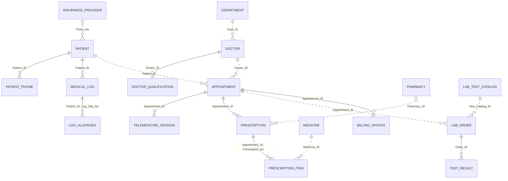

# System and database design

- [Architecture](architecture.md): application/database connections, transactions, timeline refresh and deployment.
- [Relational schema](relational-schema.md): all 18 Oracle relations, primary/foreign keys, constraints and routines.
- [Normalization](normalization.md): initial relation, functional dependencies and decomposition through 3NF.
- [Complete ER source](er-diagram.mmd): implemented columns and key annotations.

## ER diagram

This relationship overview follows the implemented SQL schema. A circle at a parent end indicates a nullable reference in the child; crow's feet indicate multiple child rows. Solid lines identify relationships whose FK columns form part of the child's PK; dashed lines represent other references. Notation follows the [Mermaid ER syntax](https://mermaid.js.org/syntax/entityRelationshipDiagram.html). The complete column/key definitions are in the schema reference above.

Cassandra's separate patient/month read model and deliberate denormalization are explained in the architecture and normalization documents. Application/database evidence is indexed in [screenshots/](../screenshots/README.md), with expected/actual checks in [tests/](../tests/README.md).
