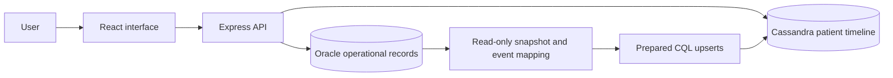

# System architecture



The browser calls one API and never connects directly to either database. Locally, Vite proxies `/api` to Express on port 3000. On Vercel, frontend and API share an origin; `api/index.js` adapts requests to Express. Server configuration holds database credentials and wallet/bundle material. Production routes require a signed demonstration-session cookie and origin checks for writes.

## Oracle transactions

Oracle holds 18 related tables for identity, clinical history, appointments, prescriptions, laboratory testing and invoices. Foreign keys/checks enforce relationships and allowed values. Patient registration and appointment-status changes use PL/SQL procedures; invoices use `CALCULATE_INVOICE_TOTAL`.

Prescription creation inserts a header and its items in one transaction. `PREVENT_ALLERGIC_PRESCRIPTION` compares a medicine's allergen class with recorded allergies; conflicts raise ORA-20002. The API returns HTTP 409 and rolls back the header and all items. `TRG_CREATE_TELEMEDICINE_SESSION` creates placeholder metadata after a virtual appointment insert, within the same transaction.

Invoices sum medicine quantities multiplied by current catalog prices and ordered laboratory charges. Changed charges require pending-invoice recalculation before payment status can be recorded. Paid/refunded appointments reject additional charges through the API workflow. Payment/refund statuses do not transfer money.

## Cassandra model and refresh

```cql
PRIMARY KEY ((patient_id, event_month), event_time, event_id)
```

The partition key groups a patient's records for a month. Clustering orders timestamps descending and event IDs ascending. Medical history, appointments, prescriptions, lab orders, lab results and invoices map to six event categories. Copied names/summaries support timeline reads without joins.

The importer opens a consistent, read-only Oracle snapshot, maps stable source identities and executes prepared Cassandra upserts. Repeated keys update events. The API validates patient/month parameters and signs paging cursors bound to the same query. Calendar dates are represented at UTC midnight to preserve source dates across host time zones.

Refresh is application-level copying, not an Oracle trigger, replication or a distributed transaction. Successful partial writes remain and can be retried. Source deletions/key-date changes can leave older events. Connection indicators report availability rather than freshness; Oracle remains authoritative for prescription/billing decisions.

## Deployment

Local Docker configuration pins Cassandra 5.0.9 with one node and persistent storage. Hosting uses Astra DB with a Secure Connect Bundle and scoped token. The local setup does not establish multi-node failover/scaling. See [Vercel](../deploy/VERCEL.md) and [Astra](../deploy/CASSANDRA.md) configuration.
